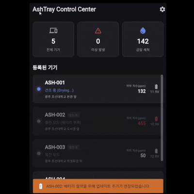
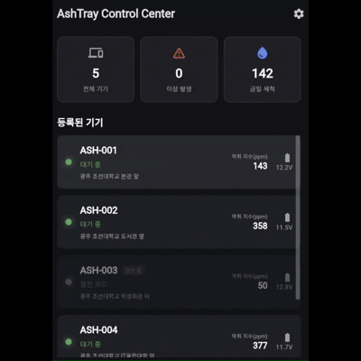
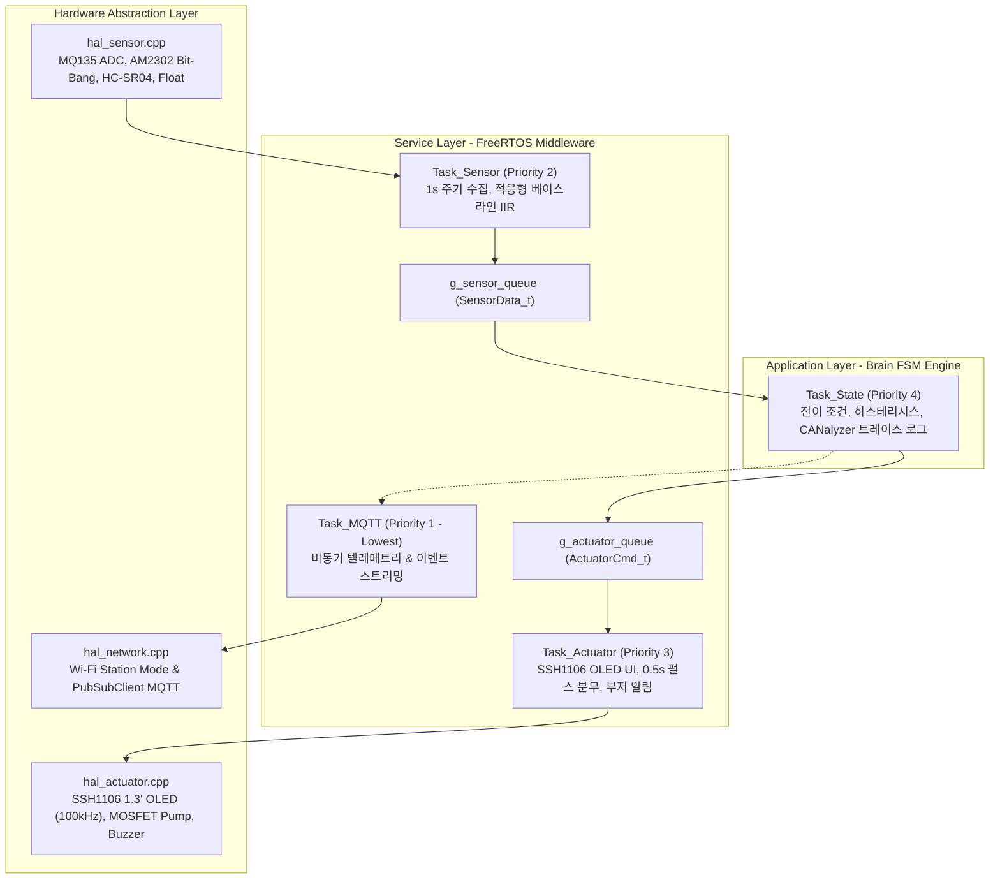

# 🚬 스마트 클린 애쉬트레이 (Smart Clean Ashtray, SCA)

> **일본의 실내 분연(分煙) 문화 및 국내 지정 실내 흡연 장소에 최적화된 화재 예방 & 공기질 케어 '컴팩트 일체형 스마트 가전형 재떨이'**
>
> **ESP32-S3 기반 3-Layer 전장 아키텍처 & FreeRTOS FSM 엔진 및 웹 모니터링 대시보드 통합 솔루션**

본 프로젝트는 일본 내 흡연 부스, 흡연 카페, 오피스 실내 흡연실 등의 **테이블탑(Table-top) 배치 환경**에 최적화된 차세대 지능형 가전 재떨이 솔루션입니다. 꽁초 방치로 인한 실내 화재 위험과 악취를 근본적으로 차단하기 위해, **ESP32-S3 기반 전장급 3-Layer 아키텍처**와 **소형 소화 미스트 수조 모듈**을 일체화하여 가전제품 수준의 안전성과 완성도를 구현했습니다.

<br>

## 📺 Project Preview

| 📱 관리자 대시보드 (App/Web) | ⚙️ 원격 시퀀스 제어 |
| :---: | :---: |
|  |  |

<br>

## 🚀 핵심 기능 (Key Features)

### 1. 실내 공기질 모니터링 (Indoor Air Monitoring)
- **적응형 IIR 베이스라인 기반 공기질 측정**: $MQ-135$ 가스 센서와 $DHT22(AM2302)$ 온습도 센서를 결합하여 실내 공기 상태(Diff)를 실시간 분석하고 공기질 상태를 도출
- **영점 드리프트 자동 보정**: 평상시(IDLE) 공기질 베이스라인을 $\alpha=0.1$ IIR 필터로 연속 추종하여 센서 노화 및 환경 변화에 따른 오탐지를 방지

### 2. 복합 화재 감지 및 펄스 소화 (Pulse Fire Extinguishing)
- **복합 판정 알고리즘**: 가스 변화량($\text{Diff} > 50$)과 시간당 온도 변화율($dT/dt > 2.0^\circ\text{C/s}$)을 교차 분석하여 단순 담배 연기와 화재를 명확히 구분
- **0.5초 펄스 미스트 제어**: 위험 상태($50^\circ\text{C}$ 이상)가 $3$초 이상 지속될 경우 `FIRE_DETECTED`로 전이, **0.5초 분사 $\rightarrow$ 1초 대기 $\rightarrow$ 재측정** 방식의 펄스 제어로 화재 진압 및 수조 낭비 방지

### 3. 직관적인 사용자 인터페이스 (Multimodal UI)
- **1.3인치 SSH1106 OLED**: 실시간 시스템 FSM 상태, 공기질(AQI Status), 온도(°C), 재 적재량(%)을 한눈에 시각화
- **시청각 피드백**: WS2812B RGB LED 상태 색상(Green/Yellow/Red/Purple) 및 능동 부저(단발 비프 / 긴급 화재 사이렌) 연동

### 4. 내부 적재량 측정 및 비움 안내 (Ash Accumulation Sensing)
- **초음파 정밀 거리 측정**: $HC-SR04$ 초음파 센서를 활용하여 내부 꽁초 적재량을 백분율($0\sim 100\%$)로 환산
- **스마트 비움 경보 (ASH_FULL)**: 반사 펄스가 $300\mu s$ 이하로 감지될 시 즉각 OLED와 부저로 비움 시점을 안내하며, $350\mu s$ 히스테리시스 적용으로 경계면 오동작 방지

### 5. 페일세이프 예외 처리 및 공회전 방지 (Safety & Dry-Run Interlock)
- **하드웨어 수위 감지**: 플로트 스위치(Float Switch)로 수조 잔량을 실시간 감시, 물 부족 시 즉각 `SYS_STATE_ERROR` 전이 및 펌프 강제 락아웃(Lockout)을 통해 펌프 소손 원천 방지

### 6. 실시간 원격 모니터링 (FreeRTOS Background MQTT)
- **독립 태스크 텔레메트리**: FreeRTOS 최하위 우선순위 태스크(Priority 1)에서 공기질, 수위 상태, 적재량, FSM 상태를 2초 주기로 클라우드(Cafe24 VPS / Mosquitto) 및 관리자 웹 대시보드로 실시간 스트리밍

<br>

## 🛠 Tech Stack

### Hardware Strategy


### Embedded & Firmware


### Communication & Cloud


### Testing & Quality (ASPICE SWE.4)


### Mobile & Management


### Collaboration & Management


<br>

## 🏗 시스템 아키텍처 (System Architecture)

### 3-Layer 전장 임베디드 구조



<br>

## 🔌 하드웨어 결선도 (Hardware Pinout)

| 분류 | 부품명 | ESP32-S3 핀 | 설명 |
| :--- | :--- | :--- | :--- |
| **Gas Sensor** | MQ-135 | **GPIO 5** | 아날로그 입력 (12-bit ADC1_CH4, 0~4095) |
| **Ultrasonic Trig** | HC-SR04 | **GPIO 6** | $10\mu s$ 초음파 트리거 출력 |
| **Ultrasonic Echo** | HC-SR04 | **GPIO 7** | 에코 펄스 수신 (FreeRTOS Watchdog 갱신) |
| **Water Level** | Float Switch | **GPIO 8** | 내부 풀업, Active LOW (소화수 부족 감지) |
| **Temp & Humidity** | AM2302 (DHT22) | **GPIO 14** | 마이크로초 정밀 단일선 비트뱅잉 통신 |
| **OLED SDA** | SSH1106 (1.3") | **GPIO 21** | I2C Data ($100\text{kHz}$ 표준 노이즈 내성 모드) |
| **OLED SCL** | SSH1106 (1.3") | **GPIO 47** | I2C Clock ($100\text{kHz}$ 표준 모드) |
| **Buzzer** | Active Buzzer | **GPIO 17** | 경고음 (1회 비프) / 화재 비상 사이렌 (연속) |
| **Water Pump** | F5305S MOSFET | **GPIO 18** | 소화수 미스트 펄스 분무 제어 ($0.5\text{s}$ ON / $1.0\text{s}$ OFF) |
| **LED** | WS2812B RGB | **GPIO 4** | 상태별 멀티모달 피드백 LED |

<br>

## 📡 클라우드 MQTT 통신 규격

* **Target Broker**: Cafe24 VPS Mosquitto (`port: 1883`)

### 1. 실시간 텔레메트리 (`ashtray/v1/telemetry`, 2초 주기 발행)
```json
{
  "dev_id": "SCA_NODE_DEV_01",
  "state": "IDLE",
  "gas_raw": 220,
  "gas_diff": 12,
  "temp": 24.5,
  "ash_pct": 15,
  "echo_us": 3500,
  "water_empty": false,
  "uptime": 128
}
```

### 2. 긴급 이벤트 브로드캐스트 (`ashtray/v1/event`, 상태 전이 시 즉시 1회 발행)
```json
{
  "dev_id": "SCA_NODE_DEV_01",
  "event": "FIRE_DETECTED",
  "temp": 52.3,
  "ash_pct": 20
}
```

<br>

## 🧪 검증 및 자동화 단위 테스트 (ASPICE SWE.4)

회귀 테스트(Regression Test) 및 V-모델 단위 검증을 지원합니다:
- **Sub UT (`test_sub_transitions.cpp`)**: 각 상태별 임계치 및 히스테리시스 불감대 경계값 단일 검증
- **Top UT (`test_top_scenarios.cpp`)**: 정상 흡연 $\rightarrow$ 꽁초 화재 발화 $\rightarrow$ 소화 펄스 $\rightarrow$ 냉각 복귀 미션 프로파일 라이프사이클 시나리오 검증

```powershell
# PC Native 초고속 단위 테스트 실행 (1초 미만 소요)
pio test -e native -f test_state_machine

# ESP32-S3 실기기 타겟 테스트 실행
pio test -e esp32-s3-devkitc-1 -f test_state_machine
```

<br>

## 🔗 관련 문서 (Documents)
- [Team Notion: 프로젝트 관리 및 회의록](여기에 노션 링크)
- [Jira Board: 업무 스케줄 및 이슈 관리](여기에 지라 링크 - 공개 가능한 경우)

<br>

## 🛠 협업 규칙 (Collaboration Rules)

### 📌 Git Commit Convention
팀원 간의 원활한 코드 리뷰와 히스토리 파악을 위해 아래의 커밋 메시지 규칙을 준수합니다.
- 메시지 형식: `태그: 작업 내용` (예: `feat: MQTT 실시간 데이터 전송 로직 구현`)

| 태그 | 설명 |
| :--- | :--- |
| **feat** | 새로운 기능 추가 |
| **fix** | 버그 수정 |
| **design** | UI 디자인 수정 및 3D 모델링(STL) 작업 |
| **docs** | 문서 수정 (README, PRD, SRS, PPT 등) |
| **refactor** | 코드 리팩토링 (기능 변경 없는 코드 구조 개선) |
| **chore** | 빌드 업무, 패키지 매니저 설정, .gitignore 수정 등 |
| **test** | 테스트 코드 추가 및 리팩토링 |

### 🌿 Branch Strategy
- **main**: 제품 출고 및 최종 발표용 브랜치 (가장 안정적인 버전)
- **develop**: 다음 출시 버전을 위한 개발 통합 브랜치
- **feature/기능명**: 각 파트별 세부 기능 개발 브랜치

### 🤝 Code Review & Merge
- 모든 기능 개발은 `feature/` 브랜치에서 진행합니다.
- 개발 완료 후 `develop` 브랜치로 Pull Request(PR)를 생성합니다.
- 최소 2명 이상의 팀원 승인(Approve)을 득한 후 Merge하는 것을 원칙으로 합니다.
